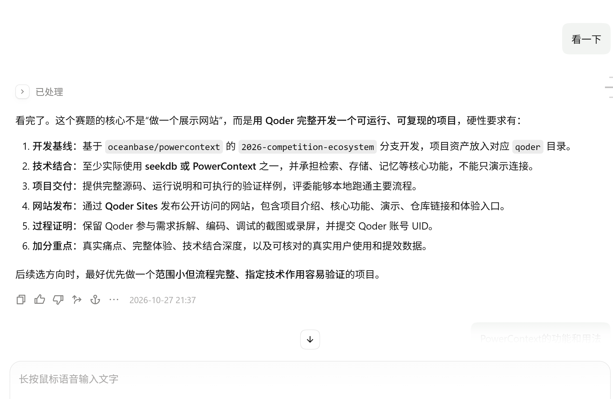
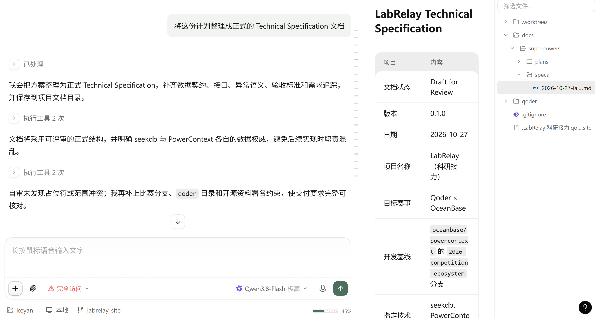
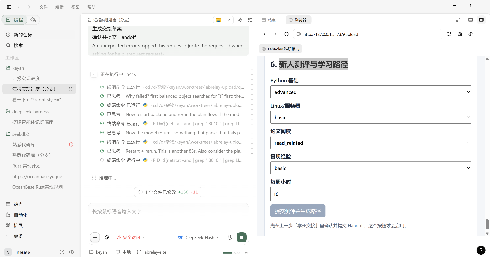

# Qoder 开发记录

本文说明 LabRelay 的主要功能由 **Qoder** 参与完成，覆盖需求拆解、规格、编码、调试、验证各环节，
并保留可核对的证据（Qoder 账号 UID、对话截图、提交历史、真实服务端运行日志）。

- **Qoder 账号 UID**：`f332e6c1-2eb9-449e-8883-fc5d2284c413`
- **开发方式**：两个 Qoder 会话并行、按「一任务一分支」协作，全程用 Qoder 桌面端（Agent 模式）驱动
  需求理解 → 规格 → TDD 编码 → 调试 → 复审 → 真实依赖验证。
- **提交历史**：本分支相对官方基线 `2026-competition-ecosystem`（`d647275`）共 **58 个提交**，
  每个 `feat:`/`fix:` 都对应一次 Qoder 会话的独立交付与复核，可用
  `git log 2026-competition-ecosystem..qoder/labrelay-2026` 逐条核对。

---

## 1. 需求拆解

Qoder 先读比赛要求原文，把它拆成 6 条**硬性要求**清单（开发基线 / 技术结合 / 项目交付 /
网站发布 / 过程证明 / 加分重点），并据此定下「范围小但流程完整、指定技术作用容易验证」的选题边界。

拆解结论直接落到开发基线约束上：项目资产放进 `qoder/` 目录、commit hash 基于
`2026-competition-ecosystem` 分支（见仓库分支结构）。

## 2. 规格（Technical Specification）

Qoder 把方案整理成正式技术规格 `docs/superpowers/specs/2026-10-27-labrelay-technical-specification.md`，
明确数据契约、接口、异常语义、验收标准与需求追踪，并**先定死 seekdb 与 PowerContext 各自的数据权威**，
避免实现时职责混乱（项目事实/进度在 seekdb，决策/交接/记忆在 PowerContext）。

规格之后由 Qoder 生成 17 个 Task 的实施计划 `docs/superpowers/plans/2026-10-27-labrelay-implementation.md`，
作为两个会话分工与验收的单一事实源。

## 3. 编码

Qoder 按实施计划逐任务编码，全程 TDD（先写失败测试，再实现，再复验）。代表性提交：

| 环节 | 提交 | Qoder 做了什么 |
| --- | --- | --- |
| 领域模型与服务编排 | `53cccbd`、`9e424df` | 建 Asset/Chunk/Citation/Evidence/Handoff/Plan/Task 模型与端口 |
| seekdb 持久化 + 混合检索 | `acd4ec4`、`7bab609`、`2e6f2f8` | 6 张核心表、PyMySQL 仓储、pyseekdb 向量+全文 RRF 检索、证据隔离 |
| HTTP API 面 | `d5568a3`、`a8f7119` | FastAPI 路由、统一错误信封、503 依赖未装配 |
| 模型网关 | `125bde0`、`d68adc7` | OpenAI 兼容生成/嵌入网关 |
| PowerContext 记忆与交接 | `0bc2dc4`、`9c3e0f4` | 适配器、Work Contract、Handoff 全链路、严格 payload 校验 |
| 计划生成与推进 | `da9d69b`、`d222a1c`、`962c99f` | 证据引用计划、进度/重规划、身份防冲突 |
| 运行时装配 + 前端 | `9d649f0`、`f80cd48`、`62fded87` | 依赖工厂、学习路径工作台、文件上传 |

## 4. 调试

Qoder 在真实依赖上定位并修复问题，而不是只在替身上跑通。截图里可见 Qoder 反复
「重启后端 → 重跑计划流 → 检查模型返回是否解析成功」的调试闭环：

真实环境调试的硬证据（均可复现）：

- **真实 seekdb 落盘**：在 WSL2 + Docker 跑起 `oceanbase/seekdb`，把之前因「无 Docker」跳过的
  集成测试变成实跑通过；发现并修复「旧库缺 `handoff_ref` 列导致首次写入 1054」的迁移缺陷
  （`69f8b43`），以及建库补列在真实库上的表重写超时（`3c5eb63d`）。
- **真实 PowerContext Server**：在 WSL 起 `powercontext[server]` 1.4.1，端到端跑通
  Scope→记忆→prepare→commit→continue→acknowledge→outcome（全 2xx），并揪出内存替身照不出的
  **409 source_conflict**（多个 capture 复用了同一 `source_id`），修复见 `00285c9`。
  记录见 `docs/verification/powercontext-live.md`。
- **中文检索排序**：发现中文查询在词法通道排不上，Qoder 定位后加了 CJK 分词修正（`084e94ba`）。

## 5. 验证与质量

- 离线单测 **487 项通过**、5 项门控跳过（需真实库才跑）；门控 live：seekdb 集成 4 项 +
  PowerContext 全链路 1 项均已实跑通过。
- `ruff check src tests` 全部通过。
- 独立代码复审（两个会话互为评审）修掉了 reviewer 提出的服务端会拒绝的 payload、跨会话草稿串扰等问题。
- HTTP 冒烟 + 浏览器全流程（建项目→上传→检索→交接→测评→生成路径→推进→问答）走通。

## 6. 如何核对

1. 提交历史：`git log 2026-competition-ecosystem..qoder/labrelay-2026`（58 个提交，逐条 feat/fix/test/docs）。
2. 真实运行证据：`docs/verification/powercontext-live.md`（服务端成功操作日志序列）与
   `docs/verification/acceptance-sample.md`（17 步验收样例）。
3. 账号归属：Qoder 账号 UID `f332e6c1-2eb9-449e-8883-fc5d2284c413`。
